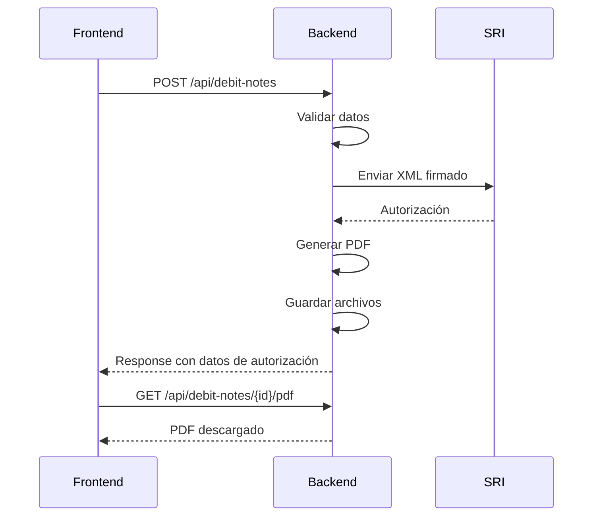
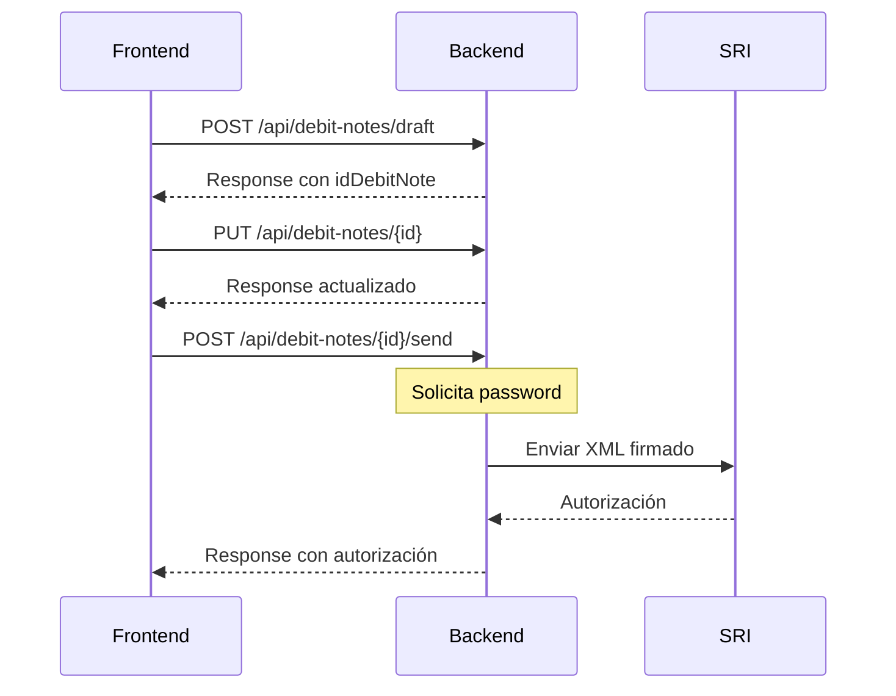
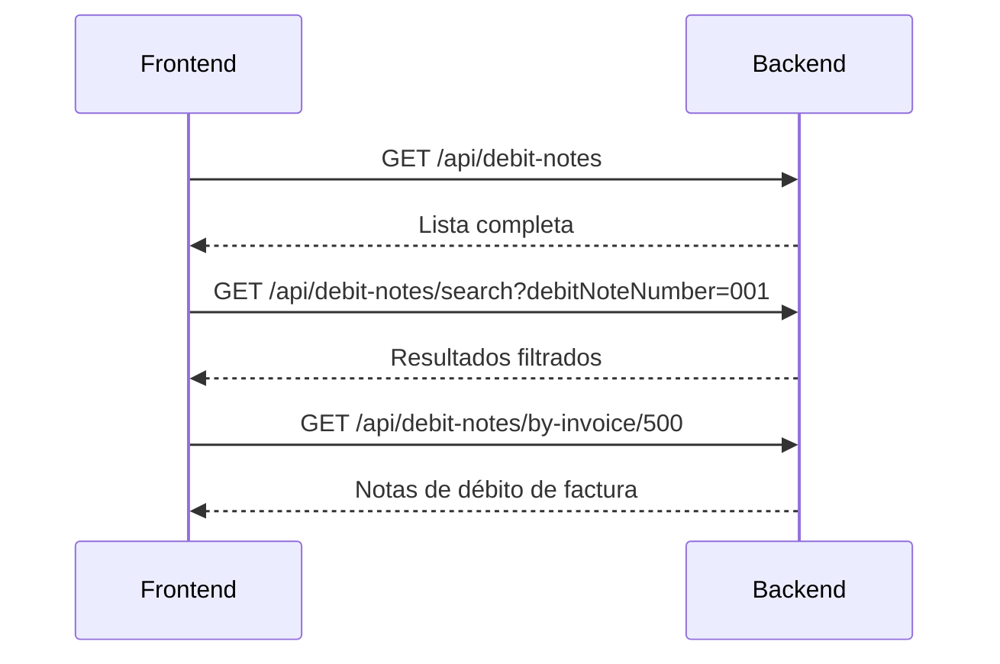

# 📄 Documentación Técnica - API de Notas de Débito

**Versión:** 1.0.0  
**Fecha:** Diciembre 2025  
**Base URL:** `http://localhost:8480/api/debit-notes`

---

## 📋 Tabla de Contenidos

1. [Información General](#información-general)
2. [Endpoints Disponibles](#endpoints-disponibles)
3. [Modelos de Datos](#modelos-de-datos)
4. [Validaciones Importantes](#validaciones-importantes)
5. [Códigos de Respuesta](#códigos-de-respuesta)
6. [Flujos de Trabajo](#flujos-de-trabajo)
7. [Ejemplos de Integración](#ejemplos-de-integración)

---

## 🌐 Información General

### URL Base

| Ambiente       | URL Base                    |
| -------------- | --------------------------- |
| **Localhost**  | `http://localhost:8480`     |
| **Desarrollo** | `http://85.239.237.88:8480` |

### Headers Comunes

```http
Content-Type: application/json
Accept: application/json
Authorization: Bearer <token>  # Si se implementa autenticación
```

### Conceptos Clave

- **Nota de Débito:** Documento que modifica una factura aumentando el monto a pagar
- **Borrador:** Nota de débito guardada sin enviar al SRI (puede editarse/eliminarse)
- **Autorizada:** Nota de débito enviada y autorizada por el SRI
- **Motivos:** Razones por las que se emite la nota de débito (intereses, recargos, etc.)

---

## 🚀 Endpoints Disponibles

### 1. Listar Todas las Notas de Débito

**GET** `/api/debit-notes`

Obtiene la lista completa de todas las notas de débito con datos del cliente incluidos.

**Request:**

```http
GET http://localhost:8480/api/debit-notes
```

**Response - Success (200):**

```json
[
  {
    "idDebitNote": 1,
    "idCompany": 1,
    "idClient": 100,
    "idIssuancePoint": 1,
    "sequential": 123,
    "retryCount": 0,
    "issueDate": "2025-12-19T10:30:00",
    "debitNoteNumber": "001-001-000000123",
    "environment": "PRODUCCION",
    "additionalInformation": "Información adicional",
    "totalAmount": 172.50,
    "subtotalZero": 0.00,
    "subtotalIva": 150.00,
    "subtotalIce": 0.00,
    "discount": 0.00,
    "totalIva": 22.50,
    "totalIce": 0.00,
    "valorModificacion": 150.00,
    "valorTotal": 172.50,
    "observation": "Intereses por mora",
    "emailSent": true,
    "emailSentDate": "2025-12-19T10:35:00",
    "originalInvoiceId": 500,
    "originalAccessKey": "1912102501179000000000120010010000005001234567890",
    "originalInvoiceNumber": "001-001-000000500",
    "originalIssueDate": "2025-12-10T08:00:00",
    "documentTypeModified": "01",
    "authorizationSri": {
      "idAuthorizationSri": 1,
      "accessKey": "1912192501179000000000120010010000001231234567810",
      "authorizationNumber": "1912192501179000000000120010010000001231234567810",
      "authorizationDate": "2025-12-19T10:32:00",
      "authorizationStatusSri": "AUTORIZADO",
      "receptionStatusSri": "RECIBIDA"
    },
    "debitNoteDetails": [
      {
        "idDebitNoteDetail": 1,
        "productDto": {
          "idProduct": 50,
          "mainCode": "SERV001",
          "name": "Intereses por mora",
          "description": "Intereses por mora en factura 500"
        },
        "unitPrice": 100.00,
        "discount": 0.00,
        "subtotal": 100.00,
        "quantity": 1
      }
    ],
    "creationDate": "2025-12-19T10:30:00",
    "updateDate": "2025-12-19T10:32:00",
    "status": true,
    "buyerName": "JUAN PEREZ CLIENTE",
    "buyerIdentification": "1712345678001",
    "debitNoteStatus": "AUTORIZADO"
  }
]
```

**Campos Importantes:**

| Campo | Tipo | Descripción |
|-------|------|-------------|
| `debitNoteStatus` | String | Estado: `BORRADOR`, `AUTORIZADO`, `DEVUELTA`, `EN_PROCESO` |
| `buyerName` | String | Nombre del cliente (incluido para evitar consultas adicionales) |
| `buyerIdentification` | String | Identificación del cliente |
| `valorModificacion` | BigDecimal | Suma de motivos sin impuestos |
| `valorTotal` | BigDecimal | Total con impuestos |

---

### 2. Obtener Nota de Débito por ID

**GET** `/api/debit-notes/{id}`

Obtiene los detalles completos de una nota de débito específica.

**Request:**

```http
GET http://localhost:8480/api/debit-notes/1
```

**Response - Success (200):**

```json
{
  "idDebitNote": 1,
  "idCompany": 1,
  "idClient": 100,
  "idIssuancePoint": 1,
  "sequential": 123,
  "companyDto": {
    "idCompany": 1,
    "identification": "1790000000001",
    "name": "EMPRESA DE PRUEBA S.A.",
    "status": true
  },
  "clientDto": {
    "idClient": 100,
    "identification": "1712345678001",
    "name": "JUAN PEREZ CLIENTE",
    "status": true
  },
  "creationDate": "2025-12-19T10:30:00",
  "issueDate": "2025-12-19",
  "accessKey": "1912192501179000000000120010010000001231234567810",
  "debitNoteNumber": "001-001-000000123",
  "authorizationNumber": "1912192501179000000000120010010000001231234567810",
  "additionalInformation": "Información adicional",
  "authorizationDate": "2025-12-19T10:32:00",
  "totalAmount": 172.50,
  "discount": 0.00,
  "subtotalZero": 0.00,
  "subtotalIva": 150.00,
  "subtotalIce": 0.00,
  "totalIva": 22.50,
  "totalIce": 0.00,
  "valorModificacion": 150.00,
  "valorTotal": 172.50,
  "environment": "PRODUCCION",
  "status": "AUTORIZADO",
  "debitNoteDetails": [
    {
      "idDebitNoteDetail": 1,
      "idProduct": 50,
      "productDto": {
        "idProduct": 50,
        "mainCode": "SERV001",
        "name": "Intereses por mora",
        "description": "Intereses por mora en factura 500",
        "unitPrice": 100.00,
        "rate": 0.15,
        "taxCode": "2",
        "taxCodPercentage": "4"
      },
      "unitPrice": 100.00,
      "discount": 0.00,
      "subtotal": 100.00,
      "quantity": 1
    },
    {
      "idDebitNoteDetail": 2,
      "idProduct": 51,
      "productDto": {
        "idProduct": 51,
        "mainCode": "SERV002",
        "name": "Recargos adicionales",
        "description": "Recargos adicionales no contemplados",
        "unitPrice": 50.00,
        "rate": 0.15,
        "taxCode": "2",
        "taxCodPercentage": "4"
      },
      "unitPrice": 50.00,
      "discount": 0.00,
      "subtotal": 50.00,
      "quantity": 1
    }
  ],
  "establishment": {
    "idEstablishment": 1,
    "type": "MATRIZ",
    "address": "AV. AMAZONAS Y COREA, QUITO"
  },
  "originalInvoiceId": 500,
  "idInvoice": 500,
  "originalAccessKey": "1912102501179000000000120010010000005001234567890",
  "originalInvoiceNumber": "001-001-000000500",
  "originalIssueDate": "2025-12-10",
  "documentTypeModified": "01",
  "observation": "Intereses por mora en factura 500",
  "paymentMethods": [
    {
      "idPaymentMethod": 1,
      "paymentMethodType": "SIN UTILIZACION DEL SISTEMA FINANCIERO",
      "paymentMethodCode": "01",
      "total": 172.50,
      "term": 0,
      "timeUnit": "días"
    }
  ]
}
```

**Response - Not Found (404):**

```json
{
  "timestamp": "2025-12-19T10:30:00",
  "status": 404,
  "error": "Not Found",
  "message": "Nota de débito no encontrada"
}
```

---

### 3. Crear y Enviar Nota de Débito al SRI

**POST** `/api/debit-notes`

Crea una nueva nota de débito y la envía automáticamente al SRI para autorización.

**Request:**

```http
POST http://localhost:8480/api/debit-notes
Content-Type: application/json
```

```json
{
  "idCompany": 1,
  "idClient": 100,
  "idIssuancePoint": 1,
  "issueDate": "2025-12-19",
  "companyDto": {
    "idCompany": 1,
    "identification": "1790000000001",
    "name": "EMPRESA DE PRUEBA S.A.",
    "status": true
  },
  "clientDto": {
    "idClient": 100,
    "identification": "1712345678001",
    "name": "JUAN PEREZ CLIENTE",
    "status": true
  },
  "originalInvoiceId": 500,
  "idInvoice": 500,
  "originalInvoiceNumber": "001-001-000000500",
  "originalIssueDate": "2025-12-10",
  "documentTypeModified": "01",
  "observation": "Intereses por mora en factura 500",
  "debitNoteDetails": [
    {
      "productDto": {
        "idProduct": 50,
        "mainCode": "SERV001",
        "name": "Intereses por mora",
        "description": "Intereses por mora en factura 500",
        "unitPrice": 100.00,
        "rate": 0.15,
        "taxCode": "2",
        "taxCodPercentage": "4"
      },
      "unitPrice": 100.00,
      "discount": 0.00,
      "subtotal": 100.00,
      "quantity": 1
    },
    {
      "productDto": {
        "idProduct": 51,
        "mainCode": "SERV002",
        "name": "Recargos adicionales",
        "description": "Recargos adicionales no contemplados",
        "unitPrice": 50.00,
        "rate": 0.15,
        "taxCode": "2",
        "taxCodPercentage": "4"
      },
      "unitPrice": 50.00,
      "discount": 0.00,
      "subtotal": 50.00,
      "quantity": 1
    }
  ],
  "establishment": {
    "idEstablishment": 1,
    "type": "MATRIZ"
  },
  "paymentMethods": [
    {
      "idPaymentMethod": 1,
      "paymentMethodCode": "01",
      "total": 172.50,
      "term": 0,
      "timeUnit": "días"
    }
  ],
  "totalAmount": 172.50,
  "valorModificacion": 150.00,
  "valorTotal": 172.50,
  "subtotalIva": 150.00,
  "totalIva": 22.50
}
```

**Response - Success (200):**

```json
{
  "code": 200,
  "status": "OK",
  "message": "Nota de débito creada y enviada al SRI exitosamente",
  "debitNoteDto": {
    "idDebitNote": 1,
    "debitNoteNumber": "001-001-000000123",
    "accessKey": "1912192501179000000000120010010000001231234567810",
    "authorizationNumber": "1912192501179000000000120010010000001231234567810",
    "authorizationDate": "2025-12-19T10:32:00",
    "authorizationStatusSri": "AUTORIZADO",
    "receptionStatusSri": "RECIBIDA"
  },
  "idDebitNote": 1,
  "debitNoteNumber": "001-001-000000123",
  "accessKey": "1912192501179000000000120010010000001231234567810",
  "authorizationNumber": "1912192501179000000000120010010000001231234567810",
  "authorizationDate": "2025-12-19T10:32:00",
  "authorizationStatusSri": "AUTORIZADO",
  "receptionStatusSri": "RECIBIDA"
}
```

**Response - Error (400):**

```json
{
  "code": 400,
  "status": "ERROR",
  "message": "La fecha de la nota de débito no puede ser anterior a la fecha de la factura original"
}
```

---

### 4. Guardar Nota de Débito como Borrador

**POST** `/api/debit-notes/draft`

Guarda una nota de débito sin enviarla al SRI. Puede editarse o eliminarse posteriormente.

**Request:**

```http
POST http://localhost:8480/api/debit-notes/draft
Content-Type: application/json
```

```json
{
  "idCompany": 1,
  "idClient": 100,
  "idIssuancePoint": 1,
  "issueDate": "2025-12-19",
  "companyDto": {
    "idCompany": 1,
    "identification": "1790000000001",
    "name": "EMPRESA DE PRUEBA S.A.",
    "status": true
  },
  "clientDto": {
    "idClient": 100,
    "identification": "1712345678001",
    "name": "JUAN PEREZ CLIENTE",
    "status": true
  },
  "originalInvoiceId": 500,
  "idInvoice": 500,
  "originalInvoiceNumber": "001-001-000000500",
  "originalIssueDate": "2025-12-10",
  "documentTypeModified": "01",
  "observation": "Intereses por mora en factura 500",
  "debitNoteDetails": [
    {
      "productDto": {
        "idProduct": 50,
        "mainCode": "SERV001",
        "name": "Intereses por mora",
        "description": "Intereses por mora en factura 500",
        "unitPrice": 100.00,
        "rate": 0.15,
        "taxCode": "2",
        "taxCodPercentage": "4"
      },
      "unitPrice": 100.00,
      "discount": 0.00,
      "subtotal": 100.00,
      "quantity": 1
    }
  ],
  "establishment": {
    "idEstablishment": 1,
    "type": "MATRIZ"
  },
  "paymentMethods": [
    {
      "idPaymentMethod": 1,
      "paymentMethodCode": "01",
      "total": 115.00,
      "term": 0,
      "timeUnit": "días"
    }
  ],
  "totalAmount": 115.00,
  "valorModificacion": 100.00,
  "valorTotal": 115.00,
  "subtotalIva": 100.00,
  "totalIva": 15.00
}
```

**Response - Success (200):**

```json
{
  "code": 200,
  "status": "OK",
  "message": "Nota de débito guardada como borrador",
  "idDebitNote": 1,
  "debitNoteDto": {
    "idDebitNote": 1,
    "status": "BORRADOR"
  }
}
```

---

### 5. Actualizar Nota de Débito (Solo Borradores)

**PUT** `/api/debit-notes/{id}`

Actualiza una nota de débito que esté en estado `BORRADOR`.

**Request:**

```http
PUT http://localhost:8480/api/debit-notes/1
Content-Type: application/json
```

```json
{
  "idDebitNote": 1,
  "issueDate": "2025-12-20",
  "observation": "Intereses por mora actualizados",
  "debitNoteDetails": [
    {
      "idDebitNoteDetail": 1,
      "productDto": {
        "idProduct": 50,
        "mainCode": "SERV001",
        "name": "Intereses por mora",
        "description": "Intereses por mora en factura 500",
        "unitPrice": 120.00,
        "rate": 0.15,
        "taxCode": "2",
        "taxCodPercentage": "4"
      },
      "unitPrice": 120.00,
      "discount": 0.00,
      "subtotal": 120.00,
      "quantity": 1
    }
  ],
  "totalAmount": 138.00,
  "valorModificacion": 120.00,
  "valorTotal": 138.00,
  "subtotalIva": 120.00,
  "totalIva": 18.00
}
```

**Response - Success (200):**

```json
{
  "code": 200,
  "status": "OK",
  "message": "Nota de débito actualizada exitosamente",
  "idDebitNote": 1
}
```

**Response - Error (400):**

```json
{
  "code": 400,
  "status": "ERROR",
  "message": "Solo se pueden actualizar notas de débito en estado BORRADOR"
}
```

---

### 6. Eliminar Nota de Débito (Solo Borradores)

**DELETE** `/api/debit-notes/{id}`

Elimina una nota de débito que esté en estado `BORRADOR`.

**Request:**

```http
DELETE http://localhost:8480/api/debit-notes/1
```

**Response - Success (204):**

Sin contenido. La nota de débito fue eliminada exitosamente.

**Response - Error (400):**

```json
{
  "code": 400,
  "status": "ERROR",
  "message": "Solo se pueden eliminar notas de débito en estado BORRADOR"
}
```

---

### 7. Buscar Notas de Débito

**GET** `/api/debit-notes/search`

Busca notas de débito aplicando filtros opcionales con paginación.

**Request:**

```http
GET http://localhost:8480/api/debit-notes/search?debitNoteNumber=001&idClient=100&originalInvoiceId=500&page=0&size=10&sort=issueDate,desc
```

**Query Parameters:**

| Parámetro | Tipo | Requerido | Descripción |
|-----------|------|-----------|-------------|
| `debitNoteNumber` | String | No | Número de nota de débito (búsqueda parcial) |
| `idClient` | Long | No | ID del cliente |
| `originalInvoiceId` | Long | No | ID de la factura original |
| `page` | Integer | No | Número de página (default: 0) |
| `size` | Integer | No | Tamaño de página (default: 20) |
| `sort` | String | No | Campo de ordenamiento (ej: `issueDate,desc`) |

**Response - Success (200):**

```json
{
  "content": [
    {
      "idDebitNote": 1,
      "debitNoteNumber": "001-001-000000123",
      "totalAmount": 172.50,
      "issueDate": "2025-12-19T10:30:00",
      "status": "AUTORIZADO"
    }
  ],
  "pageable": {
    "pageNumber": 0,
    "pageSize": 10,
    "sort": {
      "sorted": true,
      "unsorted": false
    }
  },
  "totalElements": 1,
  "totalPages": 1,
  "last": true,
  "first": true,
  "size": 10,
  "number": 0,
  "numberOfElements": 1,
  "empty": false
}
```

---

### 8. Obtener Notas de Débito por Factura Original

**GET** `/api/debit-notes/by-invoice/{originalInvoiceId}`

Obtiene todas las notas de débito asociadas a una factura original.

**Request:**

```http
GET http://localhost:8480/api/debit-notes/by-invoice/500
```

**Response - Success (200):**

```json
[
  {
    "idDebitNote": 1,
    "debitNoteNumber": "001-001-000000123",
    "totalAmount": 172.50,
    "issueDate": "2025-12-19T10:30:00",
    "status": "AUTORIZADO"
  },
  {
    "idDebitNote": 2,
    "debitNoteNumber": "001-001-000000124",
    "totalAmount": 50.00,
    "issueDate": "2025-12-20T08:00:00",
    "status": "AUTORIZADO"
  }
]
```

---

### 9. Enviar Borrador al SRI

**POST** `/api/debit-notes/{id}/send`

Envía un borrador de nota de débito al SRI para autorización.

**Request:**

```http
POST http://localhost:8480/api/debit-notes/1/send
Content-Type: application/json
```

```json
{
  "password": "contraseña_firma_digital"
}
```

**Response - Success (200):**

```json
{
  "code": 200,
  "status": "OK",
  "message": "Nota de débito enviada al SRI exitosamente",
  "debitNoteNumber": "001-001-000000123",
  "accessKey": "1912192501179000000000120010010000001231234567810",
  "authorizationNumber": "1912192501179000000000120010010000001231234567810",
  "authorizationDate": "2025-12-19T10:32:00",
  "authorizationStatusSri": "AUTORIZADO",
  "receptionStatusSri": "RECIBIDA"
}
```

**Response - Error (400):**

```json
{
  "code": 400,
  "status": "ERROR",
  "message": "La contraseña de la firma digital es requerida"
}
```

---

### 10. Descargar PDF (RIDE)

**GET** `/api/debit-notes/{id}/pdf`

Descarga el archivo PDF (RIDE) de una nota de débito autorizada.

**Request:**

```http
GET http://localhost:8480/api/debit-notes/1/pdf
```

**Response - Success (200):**

- **Content-Type:** `application/pdf`
- **Content-Disposition:** `attachment; filename="001-001-000000123.pdf"`
- **Body:** Archivo PDF binario

**Response - Error (400):**

```json
{
  "code": 400,
  "status": "ERROR",
  "message": "La nota de débito no está autorizada o el PDF no está disponible"
}
```

**Ejemplo de uso en JavaScript:**

```javascript
fetch('http://localhost:8480/api/debit-notes/1/pdf')
  .then(response => response.blob())
  .then(blob => {
    const url = window.URL.createObjectURL(blob);
    const a = document.createElement('a');
    a.href = url;
    a.download = 'nota-debito.pdf';
    a.click();
  });
```

---

### 11. Descargar XML Autorizado

**GET** `/api/debit-notes/{id}/xml`

Descarga el archivo XML autorizado de una nota de débito.

**Request:**

```http
GET http://localhost:8480/api/debit-notes/1/xml
```

**Response - Success (200):**

- **Content-Type:** `application/xml`
- **Content-Disposition:** `attachment; filename="001-001-000000123.xml"`
- **Body:** Archivo XML

**Response - Error (400):**

```json
{
  "code": 400,
  "status": "ERROR",
  "message": "La nota de débito no está autorizada o el XML no está disponible"
}
```

---

### 12. Enviar Email al Cliente

**POST** `/api/debit-notes/{id}/send-email`

Envía la nota de débito por email al cliente.

**Request:**

```http
POST http://localhost:8480/api/debit-notes/1/send-email
Content-Type: application/json
```

```json
{
  "email": "cliente@example.com"  // Opcional: email alternativo
}
```

**Response - Success (200):**

```json
{
  "success": true,
  "message": "Email enviado exitosamente"
}
```

**Response - Error (400):**

```json
{
  "success": false,
  "message": "La nota de débito no está autorizada"
}
```

---

## 📊 Modelos de Datos

### DebitNoteDto

**⚠️ IMPORTANTE:** Muchos campos se calculan automáticamente desde `debitNoteDetails`. El frontend puede enviarlos para validación, pero el backend siempre recalculará desde la fuente de verdad.

```typescript
interface DebitNoteDto {
  // ========== CAMPOS OBLIGATORIOS ==========
  /** Datos de la empresa */
  companyDto: CompanyDto;
  
  /** Datos del cliente */
  clientDto: ClientDto;
  
  /** Establecimiento y punto de emisión */
  establishment: EstablishmentDto;
  
  /** Fecha de emisión de la nota de débito */
  issueDate: string;  // ISO Date (yyyy-MM-dd)
  
  /** ID de la factura original que se modifica */
  originalInvoiceId: number;
  
  /** Número de factura original (OBLIGATORIO para SRI) */
  originalInvoiceNumber: string;
  
  /** Fecha de emisión de la factura original (OBLIGATORIO para SRI) */
  originalIssueDate: string;  // ISO Date (yyyy-MM-dd)
  
  /** Lista de detalles/productos (mínimo 1) - Fuente de verdad para motivos y totales */
  debitNoteDetails: InvoiceDetailDto[];

  // ========== CAMPOS OPCIONALES (se calculan automáticamente si no se envían) ==========
  /** Se calcula desde debitNoteDetails + impuestos */
  totalAmount?: number;
  
  /** Se calcula = suma de subtotal de todos los debitNoteDetails */
  valorModificacion?: number;
  
  /** Se calcula = valorModificacion + totalIva + totalIce */
  valorTotal?: number;
  
  /** Se calcula desde debitNoteDetails */
  subtotalZero?: number;
  
  /** Se calcula desde debitNoteDetails */
  subtotalIva?: number;
  
  /** Se calcula desde debitNoteDetails */
  subtotalIce?: number;
  
  /** Se calcula desde debitNoteDetails */
  totalIva?: number;
  
  /** Se calcula desde debitNoteDetails */
  totalIce?: number;
  
  /** Descuento total (opcional) */
  discount?: number;
  
  /** Clave de acceso de la factura original (se obtiene automáticamente si no se envía) */
  originalAccessKey?: string;

  // ========== CAMPOS OPCIONALES ==========
  /** Información adicional (solo para BD, no se envía al SRI) */
  additionalInformation?: string;
  
  /** Observación adicional (se envía como CampoAdicional en XML si existe) */
  observation?: string;
  
  /** Tipo de documento modificado (01=Factura, 03=Liquidación, etc.) - Default: "01" */
  documentTypeModified?: string;
  
  /** Lista de formas de pago (múltiples) - Si no se envía, se crea uno por defecto (01) */
  paymentMethods?: PaymentDto[];

  // ========== CAMPOS GENERADOS AUTOMÁTICAMENTE (NO enviar en request) ==========
  /** ID generado por la base de datos */
  idDebitNote?: number;
  
  /** Se extrae de companyDto.idCompany - NO enviar */
  idCompany?: number;
  
  /** Se extrae de clientDto.idClient - NO enviar */
  idClient?: number;
  
  /** Se extrae de establishment.issuancePoint.idIssuancePoint - NO enviar */
  idIssuancePoint?: number;
  
  /** Generado automáticamente - NO enviar */
  sequential?: number;
  
  /** Generado automáticamente - NO enviar */
  creationDate?: string;  // ISO DateTime
  
  /** Generado automáticamente - NO enviar */
  accessKey?: string;
  
  /** Generado automáticamente (estab-ptoEmi-secuencial) - NO enviar */
  debitNoteNumber?: string;
  
  /** Generado después de autorización - NO enviar */
  authorizationNumber?: string;
  
  /** Generado después de autorización - NO enviar */
  authorizationDate?: string;  // ISO DateTime
  
  /** Estado interno - NO enviar */
  status?: string;  // "BORRADOR" | "AUTORIZADO" | "DEVUELTA" | "EN_PROCESO"
  
  /** Ambiente (se configura en backend) - NO enviar */
  environment?: string;

  // ========== ALIAS DEPRECADOS (NO usar) ==========
  /** @deprecated Alias de originalInvoiceId - Usar originalInvoiceId */
  idInvoice?: number;
  
  /** @deprecated Alias de debitNoteDetails - Usar debitNoteDetails */
  details?: InvoiceDetailDto[];
}
```

### DebitNoteListResponseDto

```typescript
interface DebitNoteListResponseDto {
  // Identificadores
  idDebitNote: number;
  idCompany: number;
  idClient: number;
  idIssuancePoint: number;
  sequential: number;
  retryCount: number;

  // Fechas
  issueDate: string;  // ISO DateTime
  creationDate: string;
  updateDate: string;

  // Información básica
  debitNoteNumber?: string;
  environment: string;
  additionalInformation?: string;
  observation?: string;

  // Totales
  totalAmount: number;
  subtotalZero: number;
  subtotalIva: number;
  subtotalIce: number;
  discount: number;
  totalIva: number;
  totalIce: number;
  valorModificacion: number;
  valorTotal: number;

  // Factura original
  originalInvoiceId: number;
  originalAccessKey?: string;
  originalInvoiceNumber?: string;
  originalIssueDate: string;
  documentTypeModified?: string;

  // Cliente (incluido para evitar consultas adicionales)
  buyerName: string;
  buyerIdentification: string;

  // Estado
  debitNoteStatus: string;  // "BORRADOR" | "AUTORIZADO" | "DEVUELTA" | "EN_PROCESO"
  status: boolean;

  // Email
  emailSent: boolean;
  emailSentDate?: string;

  // Relaciones
  authorizationSri?: AuthorizationSri;
  debitNoteDetails: DebitNoteDetail[];
}
```

### InvoiceDetailDto (Usado para DebitNoteDetails)

```typescript
interface InvoiceDetailDto {
  idDebitNoteDetail?: number;
  idProduct?: number;
  productDto: ProductDto;
  unitPrice: number;
  discount?: number;
  subtotal: number;
  quantity: number;

  // Campos adicionales para edición
  code?: string;
  mainCode?: string;
  auxCode?: string;
  description?: string;
  ivaPercentage?: number;
  ivaValue?: number;
  iceValue?: number;
}
```

### ProductDto

```typescript
interface ProductDto {
  idProduct: number;
  mainCode: string;
  name: string;
  description?: string;
  unitPrice: number;
  rate: number;  // Tasa de IVA (ej: 0.15 para 15%)
  taxCode: string;  // "2" = IVA, "3" = ICE
  taxCodPercentage: string;  // "4" = 15%, "2" = 12%, etc.
  status: boolean;
}
```

### PaymentDto

```typescript
interface PaymentDto {
  idPaymentMethod: number;
  paymentMethodType?: string;
  paymentMethodCode: string;  // "01", "15", "16", etc.
  total: number;
  term?: number;  // Plazo en días
  timeUnit?: string;  // "días", "meses", etc.
}
```

### DebitNoteResponse

```typescript
interface DebitNoteResponse {
  code: number;
  status: string;  // "OK" | "ERROR"
  message: string;
  debitNoteDtos?: DebitNoteDto[];
  debitNoteDto?: DebitNoteDto;
  idDebitNote?: number;

  // Campos de autorización SRI
  debitNoteNumber?: string;
  accessKey?: string;
  authorizationNumber?: string;
  authorizationDate?: string;
  receptionStatusSri?: string;
  authorizationStatusSri?: string;
  storagePath?: string;
}
```

---

## ⚠️ Validaciones Importantes

### 1. Validación de Fecha

- **La fecha de emisión de la nota de débito NO puede ser anterior a la fecha de emisión de la factura original.**
- Si `issueDate < originalIssueDate`, se retornará error 400.

### 2. Validación de Total

- **El total de la nota de débito debe ser igual a la suma de (motivos + impuestos).**
- Fórmula: `valorTotal = valorModificacion + totalIva + totalIce`
- Si no coincide, el sistema calculará automáticamente los valores correctos.

### 3. Validación de Detalles

- **Debe existir al menos un detalle (producto/motivo) en `debitNoteDetails`.**
- Cada detalle debe tener:
  - `productDto` con `idProduct` o información completa del producto
  - `subtotal` calculado correctamente
  - `quantity` mayor a 0

### 4. Validación de Estado

- **Solo las notas de débito en estado `BORRADOR` pueden:**
  - Actualizarse (PUT)
  - Eliminarse (DELETE)
- **Solo las notas de débito autorizadas pueden:**
  - Descargar PDF
  - Descargar XML
  - Enviar por email

### 5. Validación de Factura Original

- **La factura original debe existir y estar autorizada.**
- El campo `originalInvoiceId` o `idInvoice` es obligatorio.

---

## 📋 Códigos de Respuesta

| Código | Estado | Descripción |
|--------|--------|-------------|
| 200 | OK | Operación exitosa |
| 204 | No Content | Eliminación exitosa (sin contenido) |
| 400 | Bad Request | Error de validación o datos inválidos |
| 404 | Not Found | Recurso no encontrado |
| 500 | Internal Server Error | Error interno del servidor |

---

## 🔄 Flujos de Trabajo

### Flujo 1: Crear y Enviar Nota de Débito Inmediatamente



**Pasos:**

1. Frontend envía `POST /api/debit-notes` con todos los datos
2. Backend valida, crea, envía al SRI y autoriza
3. Frontend muestra mensaje de éxito con número de autorización
4. Frontend permite descargar PDF/XML

### Flujo 2: Crear Borrador y Enviar Después



**Pasos:**

1. Frontend envía `POST /api/debit-notes/draft` para guardar borrador
2. Usuario puede editar con `PUT /api/debit-notes/{id}`
3. Usuario confirma y envía con `POST /api/debit-notes/{id}/send` (requiere password)
4. Backend envía al SRI y retorna resultado

### Flujo 3: Listar y Filtrar Notas de Débito



---

## 💻 Ejemplos de Integración

### Ejemplo 1: Crear Nota de Débito (React/TypeScript)

```typescript
import axios from 'axios';

interface CreateDebitNoteRequest {
  idCompany: number;
  idClient: number;
  idIssuancePoint: number;
  issueDate: string;
  companyDto: CompanyDto;
  clientDto: ClientDto;
  originalInvoiceId: number;
  originalInvoiceNumber: string;
  originalIssueDate: string;
  documentTypeModified: string;
  observation?: string;
  debitNoteDetails: InvoiceDetailDto[];
  establishment?: EstablishmentDto;
  paymentMethods?: PaymentDto[];
  totalAmount: number;
  valorModificacion: number;
  valorTotal: number;
  subtotalIva: number;
  totalIva: number;
}

const createDebitNote = async (data: CreateDebitNoteRequest) => {
  try {
    const response = await axios.post<DebitNoteResponse>(
      'http://localhost:8480/api/debit-notes',
      data
    );
    
    if (response.data.code === 200) {
      console.log('Nota de débito creada:', response.data.debitNoteNumber);
      return response.data;
    } else {
      throw new Error(response.data.message);
    }
  } catch (error) {
    if (axios.isAxiosError(error)) {
      console.error('Error:', error.response?.data);
      throw error;
    }
    throw error;
  }
};

// Uso
const handleCreateDebitNote = async () => {
  const debitNoteData: CreateDebitNoteRequest = {
    idCompany: 1,
    idClient: 100,
    idIssuancePoint: 1,
    issueDate: '2025-12-19',
    companyDto: { /* ... */ },
    clientDto: { /* ... */ },
    originalInvoiceId: 500,
    originalInvoiceNumber: '001-001-000000500',
    originalIssueDate: '2025-12-10',
    documentTypeModified: '01',
    observation: 'Intereses por mora',
    debitNoteDetails: [
      {
        productDto: {
          idProduct: 50,
          mainCode: 'SERV001',
          name: 'Intereses por mora',
          description: 'Intereses por mora en factura 500',
          unitPrice: 100.00,
          rate: 0.15,
          taxCode: '2',
          taxCodPercentage: '4',
          status: true
        },
        unitPrice: 100.00,
        discount: 0.00,
        subtotal: 100.00,
        quantity: 1
      }
    ],
    totalAmount: 115.00,
    valorModificacion: 100.00,
    valorTotal: 115.00,
    subtotalIva: 100.00,
    totalIva: 15.00
  };

  try {
    const result = await createDebitNote(debitNoteData);
    alert(`Nota de débito ${result.debitNoteNumber} creada exitosamente`);
  } catch (error) {
    alert('Error al crear nota de débito');
  }
};
```

### Ejemplo 2: Listar Notas de Débito con Filtros

```typescript
const searchDebitNotes = async (
  filters: {
    debitNoteNumber?: string;
    idClient?: number;
    originalInvoiceId?: number;
  },
  page: number = 0,
  size: number = 20
) => {
  const params = new URLSearchParams();
  if (filters.debitNoteNumber) params.append('debitNoteNumber', filters.debitNoteNumber);
  if (filters.idClient) params.append('idClient', filters.idClient.toString());
  if (filters.originalInvoiceId) params.append('originalInvoiceId', filters.originalInvoiceId.toString());
  params.append('page', page.toString());
  params.append('size', size.toString());
  params.append('sort', 'issueDate,desc');

  const response = await axios.get<Page<DebitNote>>(
    `http://localhost:8480/api/debit-notes/search?${params.toString()}`
  );
  
  return response.data;
};
```

### Ejemplo 3: Descargar PDF

```typescript
const downloadDebitNotePdf = async (id: number) => {
  try {
    const response = await axios.get(
      `http://localhost:8480/api/debit-notes/${id}/pdf`,
      { responseType: 'blob' }
    );

    const url = window.URL.createObjectURL(new Blob([response.data]));
    const link = document.createElement('a');
    link.href = url;
    link.setAttribute('download', `nota-debito-${id}.pdf`);
    document.body.appendChild(link);
    link.click();
    link.remove();
  } catch (error) {
    console.error('Error al descargar PDF:', error);
    alert('No se pudo descargar el PDF');
  }
};
```

### Ejemplo 4: Enviar Borrador al SRI

```typescript
const sendDraftToSri = async (id: number, password: string) => {
  try {
    const response = await axios.post<DebitNoteResponse>(
      `http://localhost:8480/api/debit-notes/${id}/send`,
      { password }
    );

    if (response.data.code === 200) {
      console.log('Nota de débito enviada:', response.data.debitNoteNumber);
      return response.data;
    } else {
      throw new Error(response.data.message);
    }
  } catch (error) {
    if (axios.isAxiosError(error)) {
      console.error('Error:', error.response?.data);
    }
    throw error;
  }
};
```

### Ejemplo 5: Enviar Email

```typescript
const sendDebitNoteEmail = async (id: number, alternativeEmail?: string) => {
  try {
    const response = await axios.post<{ success: boolean; message: string }>(
      `http://localhost:8480/api/debit-notes/${id}/send-email`,
      alternativeEmail ? { email: alternativeEmail } : {}
    );

    if (response.data.success) {
      alert('Email enviado exitosamente');
    } else {
      alert(response.data.message);
    }
  } catch (error) {
    console.error('Error al enviar email:', error);
    alert('No se pudo enviar el email');
  }
};
```

---

## 🔍 Notas Adicionales

### Cálculo de Totales

El sistema calcula automáticamente los totales si no se proporcionan:

- `valorModificacion` = Suma de `subtotal` de todos los detalles (sin impuestos)
- `totalIva` = Suma de IVA calculado sobre cada detalle
- `totalIce` = Suma de ICE calculado sobre cada detalle
- `valorTotal` = `valorModificacion + totalIva + totalIce`

### Motivos como Productos

Los motivos de la nota de débito se registran como productos en `debitNoteDetails`:

- **Productos tipo servicio:** Intereses, recargos, diferencias de cambio
- **Productos tipo bien:** También permitidos como motivos según SRI

El campo `productDto.description` o `productDto.name` se usa como la razón (`razon`) en el XML del SRI.

### Estados de Nota de Débito

| Estado | Descripción | Acciones Permitidas |
|--------|-------------|---------------------|
| `BORRADOR` | Guardada sin enviar al SRI | Editar, Eliminar, Enviar al SRI |
| `EN_PROCESO` | Enviada al SRI, esperando respuesta | Ver, Reintentar envío |
| `AUTORIZADO` | Autorizada por el SRI | Ver, Descargar PDF/XML, Enviar email |
| `DEVUELTA` | Rechazada por el SRI | Ver, Corregir y reenviar |

---

## 📞 Soporte

Para consultas o problemas con la API, contactar al equipo de desarrollo.

**Última actualización:** Diciembre 2025

