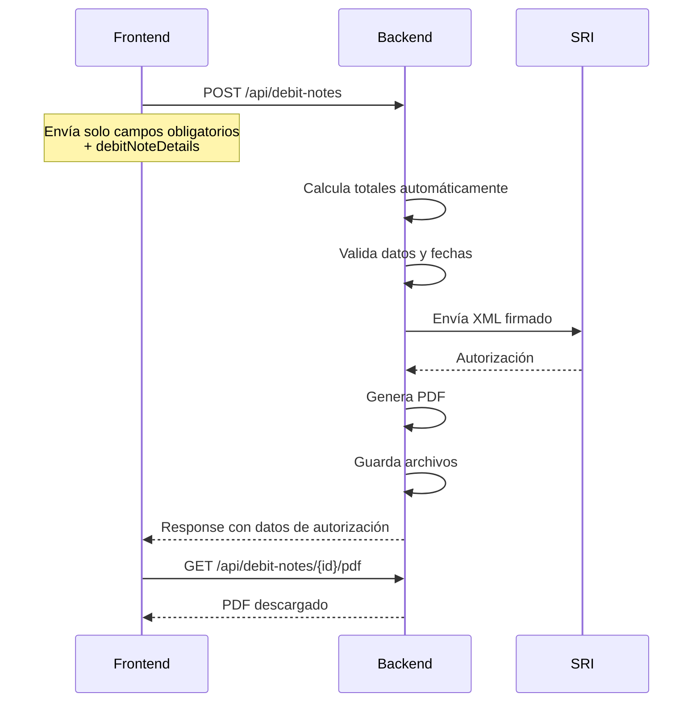
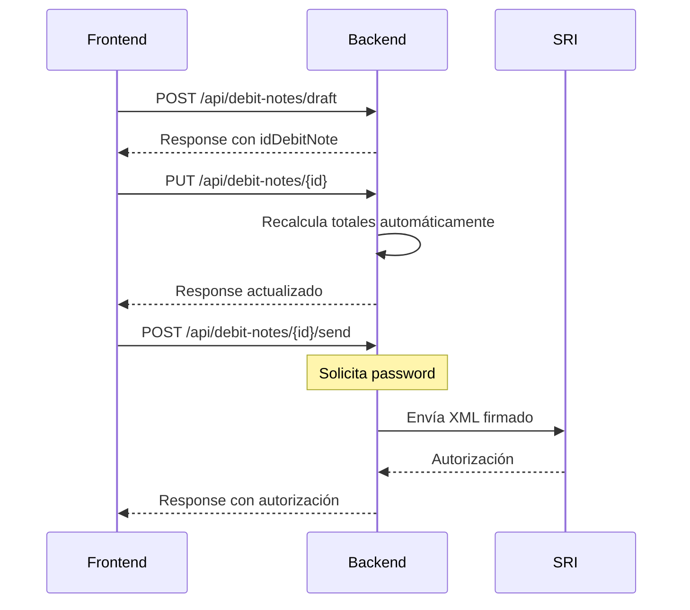

# 📄 Documentación Técnica - API de Notas de Débito para Frontend

**Versión:** 2.0.0  
**Fecha:** Diciembre 2025  
**Base URL:** `http://localhost:8480/api/debit-notes`

---

## 📋 Tabla de Contenidos

1. [Información General](#información-general)
2. [Endpoints Disponibles](#endpoints-disponibles)
3. [Modelos de Datos](#modelos-de-datos)
4. [Validaciones y Reglas de Negocio](#validaciones-y-reglas-de-negocio)
5. [Códigos de Respuesta](#códigos-de-respuesta)
6. [Flujos de Trabajo](#flujos-de-trabajo)
7. [Ejemplos de Integración](#ejemplos-de-integración)
8. [Campos Calculados Automáticamente](#campos-calculados-automáticamente)
9. [Errores Comunes y Soluciones](#errores-comunes-y-soluciones)

---

## 🌐 Información General

### URL Base

| Ambiente       | URL Base                    |
| -------------- | --------------------------- |
| **Localhost**  | `http://localhost:8480`     |
| **Desarrollo** | `http://85.239.237.88:8480` |

### Headers Comunes

```http
Content-Type: application/json
Accept: application/json
Authorization: Bearer <token>  # Si se implementa autenticación
```

### Conceptos Clave

- **Nota de Débito:** Documento que modifica una factura aumentando el monto a pagar
- **Borrador:** Nota de débito guardada sin enviar al SRI (puede editarse/eliminarse)
- **Autorizada:** Nota de débito enviada y autorizada por el SRI
- **Motivos:** Razones por las que se emite la nota de débito (intereses, recargos, etc.)
- **Totales Calculables:** Muchos campos se calculan automáticamente desde `debitNoteDetails`

---

## 🚀 Endpoints Disponibles

### 1. Listar Todas las Notas de Débito

**GET** `/api/debit-notes`

Obtiene la lista completa de todas las notas de débito con datos del cliente incluidos.

**Request:**

```http
GET http://localhost:8480/api/debit-notes
```

**Response - Success (200):**

```json
[
  {
    "idDebitNote": 1,
    "idCompany": 1,
    "idClient": 100,
    "idIssuancePoint": 1,
    "sequential": 123,
    "retryCount": 0,
    "issueDate": "2025-12-19T10:30:00",
    "debitNoteNumber": "001-001-000000123",
    "environment": "PRODUCCION",
    "additionalInformation": "Información adicional",
    "totalAmount": 172.5,
    "subtotalZero": 0.0,
    "subtotalIva": 150.0,
    "subtotalIce": 0.0,
    "discount": 0.0,
    "totalIva": 22.5,
    "totalIce": 0.0,
    "valorModificacion": 150.0,
    "valorTotal": 172.5,
    "observation": "Intereses por mora",
    "emailSent": true,
    "emailSentDate": "2025-12-19T10:35:00",
    "originalInvoiceId": 500,
    "originalAccessKey": "1912102501179000000000120010010000005001234567890",
    "originalInvoiceNumber": "001-001-000000500",
    "originalIssueDate": "2025-12-10T08:00:00",
    "documentTypeModified": "01",
    "authorizationSri": {
      "idAuthorizationSri": 1,
      "accessKey": "1912192501179000000000120010010000001231234567810",
      "authorizationNumber": "1912192501179000000000120010010000001231234567810",
      "authorizationDate": "2025-12-19T10:32:00",
      "authorizationStatusSri": "AUTORIZADO",
      "receptionStatusSri": "RECIBIDA"
    },
    "debitNoteDetails": [
      {
        "idDebitNoteDetail": 1,
        "productDto": {
          "idProduct": 50,
          "mainCode": "SERV001",
          "name": "Intereses por mora",
          "description": "Intereses por mora en factura 500"
        },
        "unitPrice": 100.0,
        "discount": 0.0,
        "subtotal": 100.0,
        "quantity": 1
      }
    ],
    "creationDate": "2025-12-19T10:30:00",
    "updateDate": "2025-12-19T10:32:00",
    "status": true,
    "buyerName": "JUAN PEREZ CLIENTE",
    "buyerIdentification": "1712345678001",
    "debitNoteStatus": "AUTORIZADO"
  }
]
```

---

### 2. Obtener Nota de Débito por ID

**GET** `/api/debit-notes/{id}`

Obtiene los detalles completos de una nota de débito específica.

**Request:**

```http
GET http://localhost:8480/api/debit-notes/1
```

**Response - Success (200):**

Ver estructura completa en [Modelos de Datos - DebitNoteDto](#debitnotedto)

**Response - Not Found (404):**

```json
{
  "timestamp": "2025-12-19T10:30:00",
  "status": 404,
  "error": "Not Found",
  "message": "Nota de débito no encontrada"
}
```

---

### 3. Crear y Enviar Nota de Débito al SRI

**POST** `/api/debit-notes`

Crea una nueva nota de débito y la envía automáticamente al SRI para autorización.

**⚠️ IMPORTANTE:** Los totales (`totalAmount`, `valorModificacion`, `valorTotal`, etc.) se calculan automáticamente desde `debitNoteDetails`. Puedes enviarlos para validación, pero el backend siempre recalculará desde la fuente de verdad.

**Request:**

```http
POST http://localhost:8480/api/debit-notes
Content-Type: application/json
```

```json
{
  "companyDto": {
    "idCompany": 1,
    "identification": "1790000000001",
    "name": "EMPRESA DE PRUEBA S.A.",
    "nameCommercial": "EMPRESA PRUEBA",
    "status": true,
    "contacts": [
      {
        "contactType": "EMAIL",
        "value": "empresa@example.com",
        "status": true
      }
    ]
  },
  "clientDto": {
    "idClient": 100,
    "identification": "1712345678001",
    "name": "JUAN PEREZ CLIENTE",
    "idType": 1,
    "status": true,
    "contacts": [
      {
        "contactType": "EMAIL",
        "value": "cliente@example.com",
        "status": true
      }
    ]
  },
  "establishment": {
    "idEstablishment": 1,
    "type": "MATRIZ",
    "code": "001",
    "address": "AV. AMAZONAS Y COREA, QUITO",
    "issuancePoint": {
      "idIssuancePoint": 1,
      "code": "001"
    }
  },
  "issueDate": "2025-12-19",
  "originalInvoiceId": 500,
  "originalInvoiceNumber": "001-001-000000500",
  "originalIssueDate": "2025-12-10",
  "documentTypeModified": "01",
  "observation": "Intereses por mora en factura 500",
  "debitNoteDetails": [
    {
      "productDto": {
        "idProduct": 50,
        "mainCode": "SERV001",
        "name": "Intereses por mora",
        "description": "Intereses por mora en factura 500",
        "unitPrice": 100.0,
        "rate": 0.15,
        "taxCode": "2",
        "taxCodPercentage": "4",
        "status": true
      },
      "unitPrice": 100.0,
      "discount": 0.0,
      "subtotal": 100.0,
      "quantity": 1
    },
    {
      "productDto": {
        "idProduct": 51,
        "mainCode": "SERV002",
        "name": "Recargos adicionales",
        "description": "Recargos adicionales no contemplados",
        "unitPrice": 50.0,
        "rate": 0.15,
        "taxCode": "2",
        "taxCodPercentage": "4",
        "status": true
      },
      "unitPrice": 50.0,
      "discount": 0.0,
      "subtotal": 50.0,
      "quantity": 1
    }
  ],
  "paymentMethods": [
    {
      "idPaymentMethod": 1,
      "paymentMethodCode": "01",
      "total": 172.5,
      "term": 0,
      "timeUnit": "días"
    }
  ]
}
```

**Campos Opcionales (se calculan automáticamente):**

```json
{
  // Estos campos son OPCIONALES - el backend los calculará automáticamente
  "totalAmount": 172.5, // Se calcula = valorModificacion + totalIva + totalIce
  "valorModificacion": 150.0, // Se calcula = suma de subtotal de debitNoteDetails
  "valorTotal": 172.5, // Se calcula = valorModificacion + totalIva + totalIce
  "subtotalZero": 0.0, // Se calcula desde debitNoteDetails
  "subtotalIva": 150.0, // Se calcula desde debitNoteDetails
  "subtotalIce": 0.0, // Se calcula desde debitNoteDetails
  "totalIva": 22.5, // Se calcula desde debitNoteDetails
  "totalIce": 0.0, // Se calcula desde debitNoteDetails
  "originalAccessKey": "...", // Se obtiene de la factura original si no se envía
  "additionalInformation": "...", // Opcional
  "discount": 0.0 // Opcional
}
```

**Response - Success (200):**

```json
{
  "code": 200,
  "status": "OK",
  "message": "Nota de débito creada y enviada al SRI exitosamente",
  "debitNoteDto": {
    "idDebitNote": 1,
    "debitNoteNumber": "001-001-000000123",
    "accessKey": "1912192501179000000000120010010000001231234567810",
    "authorizationNumber": "1912192501179000000000120010010000001231234567810",
    "authorizationDate": "2025-12-19T10:32:00",
    "authorizationStatusSri": "AUTORIZADO",
    "receptionStatusSri": "RECIBIDA"
  },
  "idDebitNote": 1,
  "debitNoteNumber": "001-001-000000123",
  "accessKey": "1912192501179000000000120010010000001231234567810",
  "authorizationNumber": "1912192501179000000000120010010000001231234567810",
  "authorizationDate": "2025-12-19T10:32:00",
  "authorizationStatusSri": "AUTORIZADO",
  "receptionStatusSri": "RECIBIDA"
}
```

**Response - Error (400):**

```json
{
  "code": 400,
  "status": "ERROR",
  "message": "La fecha de la nota de débito no puede ser anterior a la fecha de la factura original"
}
```

---

### 4. Guardar Nota de Débito como Borrador

**POST** `/api/debit-notes/draft`

Guarda una nota de débito sin enviarla al SRI. Puede editarse o eliminarse posteriormente.

**Request:**

```http
POST http://localhost:8480/api/debit-notes/draft
Content-Type: application/json
```

```json
{
  "companyDto": {
    "idCompany": 1,
    "identification": "1790000000001",
    "name": "EMPRESA DE PRUEBA S.A.",
    "status": true
  },
  "clientDto": {
    "idClient": 100,
    "identification": "1712345678001",
    "name": "JUAN PEREZ CLIENTE",
    "idType": 1,
    "status": true
  },
  "establishment": {
    "idEstablishment": 1,
    "type": "MATRIZ",
    "code": "001",
    "issuancePoint": {
      "idIssuancePoint": 1,
      "code": "001"
    }
  },
  "issueDate": "2025-12-19",
  "originalInvoiceId": 500,
  "originalInvoiceNumber": "001-001-000000500",
  "originalIssueDate": "2025-12-10",
  "documentTypeModified": "01",
  "observation": "Intereses por mora en factura 500",
  "debitNoteDetails": [
    {
      "productDto": {
        "idProduct": 50,
        "mainCode": "SERV001",
        "name": "Intereses por mora",
        "description": "Intereses por mora en factura 500",
        "unitPrice": 100.0,
        "rate": 0.15,
        "taxCode": "2",
        "taxCodPercentage": "4",
        "status": true
      },
      "unitPrice": 100.0,
      "discount": 0.0,
      "subtotal": 100.0,
      "quantity": 1
    }
  ],
  "paymentMethods": [
    {
      "idPaymentMethod": 1,
      "paymentMethodCode": "01",
      "total": 115.0,
      "term": 0,
      "timeUnit": "días"
    }
  ]
}
```

**Response - Success (200):**

```json
{
  "code": 200,
  "status": "OK",
  "message": "Nota de débito guardada como borrador",
  "idDebitNote": 1,
  "debitNoteDto": {
    "idDebitNote": 1,
    "status": "BORRADOR"
  }
}
```

---

### 5. Actualizar Nota de Débito (Solo Borradores)

**PUT** `/api/debit-notes/{id}`

Actualiza una nota de débito que esté en estado `BORRADOR`.

**Request:**

```http
PUT http://localhost:8480/api/debit-notes/1
Content-Type: application/json
```

```json
{
  "issueDate": "2025-12-20",
  "observation": "Intereses por mora actualizados",
  "debitNoteDetails": [
    {
      "idDebitNoteDetail": 1,
      "productDto": {
        "idProduct": 50,
        "mainCode": "SERV001",
        "name": "Intereses por mora",
        "description": "Intereses por mora en factura 500",
        "unitPrice": 120.0,
        "rate": 0.15,
        "taxCode": "2",
        "taxCodPercentage": "4",
        "status": true
      },
      "unitPrice": 120.0,
      "discount": 0.0,
      "subtotal": 120.0,
      "quantity": 1
    }
  ],
  "paymentMethods": [
    {
      "idPaymentMethod": 1,
      "paymentMethodCode": "01",
      "total": 138.0,
      "term": 0,
      "timeUnit": "días"
    }
  ]
}
```

**Response - Success (200):**

```json
{
  "code": 200,
  "status": "OK",
  "message": "Nota de débito actualizada exitosamente",
  "idDebitNote": 1
}
```

**Response - Error (400):**

```json
{
  "code": 400,
  "status": "ERROR",
  "message": "Solo se pueden actualizar notas de débito en estado BORRADOR"
}
```

---

### 6. Eliminar Nota de Débito (Solo Borradores)

**DELETE** `/api/debit-notes/{id}`

Elimina una nota de débito que esté en estado `BORRADOR`.

**Request:**

```http
DELETE http://localhost:8480/api/debit-notes/1
```

**Response - Success (204):**

Sin contenido. La nota de débito fue eliminada exitosamente.

**Response - Error (400):**

```json
{
  "code": 400,
  "status": "ERROR",
  "message": "Solo se pueden eliminar notas de débito en estado BORRADOR"
}
```

---

### 7. Buscar Notas de Débito

**GET** `/api/debit-notes/search`

Busca notas de débito aplicando filtros opcionales con paginación.

**Request:**

```http
GET http://localhost:8480/api/debit-notes/search?debitNoteNumber=001&idClient=100&originalInvoiceId=500&page=0&size=10&sort=issueDate,desc
```

**Query Parameters:**

| Parámetro           | Tipo    | Requerido | Descripción                                  |
| ------------------- | ------- | --------- | -------------------------------------------- |
| `debitNoteNumber`   | String  | No        | Número de nota de débito (búsqueda parcial)  |
| `idClient`          | Long    | No        | ID del cliente                               |
| `originalInvoiceId` | Long    | No        | ID de la factura original                    |
| `page`              | Integer | No        | Número de página (default: 0)                |
| `size`              | Integer | No        | Tamaño de página (default: 20)               |
| `sort`              | String  | No        | Campo de ordenamiento (ej: `issueDate,desc`) |

**Response - Success (200):**

```json
{
  "content": [
    {
      "idDebitNote": 1,
      "debitNoteNumber": "001-001-000000123",
      "totalAmount": 172.5,
      "issueDate": "2025-12-19T10:30:00",
      "status": "AUTORIZADO"
    }
  ],
  "pageable": {
    "pageNumber": 0,
    "pageSize": 10,
    "sort": {
      "sorted": true,
      "unsorted": false
    }
  },
  "totalElements": 1,
  "totalPages": 1,
  "last": true,
  "first": true,
  "size": 10,
  "number": 0,
  "numberOfElements": 1,
  "empty": false
}
```

---

### 8. Obtener Notas de Débito por Factura Original

**GET** `/api/debit-notes/by-invoice/{originalInvoiceId}`

Obtiene todas las notas de débito asociadas a una factura original.

**Request:**

```http
GET http://localhost:8480/api/debit-notes/by-invoice/500
```

**Response - Success (200):**

```json
[
  {
    "idDebitNote": 1,
    "debitNoteNumber": "001-001-000000123",
    "totalAmount": 172.5,
    "issueDate": "2025-12-19T10:30:00",
    "status": "AUTORIZADO"
  },
  {
    "idDebitNote": 2,
    "debitNoteNumber": "001-001-000000124",
    "totalAmount": 50.0,
    "issueDate": "2025-12-20T08:00:00",
    "status": "AUTORIZADO"
  }
]
```

---

### 9. Enviar Borrador al SRI

**POST** `/api/debit-notes/{id}/send`

Envía un borrador de nota de débito al SRI para autorización.

**Request:**

```http
POST http://localhost:8480/api/debit-notes/1/send
Content-Type: application/json
```

```json
{
  "password": "contraseña_firma_digital"
}
```

**Response - Success (200):**

```json
{
  "code": 200,
  "status": "OK",
  "message": "Nota de débito enviada al SRI exitosamente",
  "debitNoteNumber": "001-001-000000123",
  "accessKey": "1912192501179000000000120010010000001231234567810",
  "authorizationNumber": "1912192501179000000000120010010000001231234567810",
  "authorizationDate": "2025-12-19T10:32:00",
  "authorizationStatusSri": "AUTORIZADO",
  "receptionStatusSri": "RECIBIDA"
}
```

**Response - Error (400):**

```json
{
  "code": 400,
  "status": "ERROR",
  "message": "La contraseña de la firma digital es requerida"
}
```

---

### 10. Descargar PDF (RIDE)

**GET** `/api/debit-notes/{id}/pdf`

Descarga el archivo PDF (RIDE) de una nota de débito autorizada.

**Request:**

```http
GET http://localhost:8480/api/debit-notes/1/pdf
```

**Response - Success (200):**

- **Content-Type:** `application/pdf`
- **Content-Disposition:** `attachment; filename="001-001-000000123.pdf"`
- **Body:** Archivo PDF binario

**Response - Error (400):**

```json
{
  "code": 400,
  "status": "ERROR",
  "message": "La nota de débito no está autorizada o el PDF no está disponible"
}
```

---

### 11. Descargar XML Autorizado

**GET** `/api/debit-notes/{id}/xml`

Descarga el archivo XML autorizado de una nota de débito.

**Request:**

```http
GET http://localhost:8480/api/debit-notes/1/xml
```

**Response - Success (200):**

- **Content-Type:** `application/xml`
- **Content-Disposition:** `attachment; filename="001-001-000000123.xml"`
- **Body:** Archivo XML

**Response - Error (400):**

```json
{
  "code": 400,
  "status": "ERROR",
  "message": "La nota de débito no está autorizada o el XML no está disponible"
}
```

---

### 12. Enviar Email al Cliente

**POST** `/api/debit-notes/{id}/send-email`

Envía la nota de débito por email al cliente.

**Request:**

```http
POST http://localhost:8480/api/debit-notes/1/send-email
Content-Type: application/json
```

```json
{
  "email": "cliente@example.com" // Opcional: email alternativo
}
```

**Response - Success (200):**

```json
{
  "success": true,
  "message": "Email enviado exitosamente"
}
```

**Response - Error (400):**

```json
{
  "success": false,
  "message": "La nota de débito no está autorizada"
}
```

---

## 📊 Modelos de Datos

### DebitNoteDto

**⚠️ IMPORTANTE:** Muchos campos se calculan automáticamente desde `debitNoteDetails`. El frontend puede enviarlos para validación, pero el backend siempre recalculará desde la fuente de verdad.

```typescript
interface DebitNoteDto {
  // ========== CAMPOS OBLIGATORIOS ==========
  /** Datos de la empresa */
  companyDto: CompanyDto;

  /** Datos del cliente */
  clientDto: ClientDto;

  /** Establecimiento y punto de emisión */
  establishment: EstablishmentDto;

  /** Fecha de emisión de la nota de débito */
  issueDate: string; // ISO Date (yyyy-MM-dd)

  /** ID de la factura original que se modifica */
  originalInvoiceId: number;

  /** Número de factura original (OBLIGATORIO para SRI) */
  originalInvoiceNumber: string;

  /** Fecha de emisión de la factura original (OBLIGATORIO para SRI) */
  originalIssueDate: string; // ISO Date (yyyy-MM-dd)

  /** Lista de detalles/productos (mínimo 1) - Fuente de verdad para motivos y totales */
  debitNoteDetails: InvoiceDetailDto[];

  // ========== CAMPOS OPCIONALES (se calculan automáticamente si no se envían) ==========
  /** Se calcula desde debitNoteDetails + impuestos */
  totalAmount?: number;

  /** Se calcula = suma de subtotal de todos los debitNoteDetails */
  valorModificacion?: number;

  /** Se calcula = valorModificacion + totalIva + totalIce */
  valorTotal?: number;

  /** Se calcula desde debitNoteDetails */
  subtotalZero?: number;

  /** Se calcula desde debitNoteDetails */
  subtotalIva?: number;

  /** Se calcula desde debitNoteDetails */
  subtotalIce?: number;

  /** Se calcula desde debitNoteDetails */
  totalIva?: number;

  /** Se calcula desde debitNoteDetails */
  totalIce?: number;

  /** Descuento total (opcional) */
  discount?: number;

  /** Clave de acceso de la factura original (se obtiene automáticamente si no se envía) */
  originalAccessKey?: string;

  // ========== CAMPOS OPCIONALES ==========
  /** Información adicional (solo para BD, no se envía al SRI) */
  additionalInformation?: string;

  /** Observación adicional (se envía como CampoAdicional en XML si existe) */
  observation?: string;

  /** Tipo de documento modificado (01=Factura, 03=Liquidación, etc.) - Default: "01" */
  documentTypeModified?: string;

  /** Lista de formas de pago (múltiples) - Si no se envía, se crea uno por defecto (01) */
  paymentMethods?: PaymentDto[];

  // ========== CAMPOS GENERADOS AUTOMÁTICAMENTE (NO enviar en request) ==========
  /** ID generado por la base de datos */
  idDebitNote?: number;

  /** Se extrae de companyDto.idCompany - NO enviar */
  idCompany?: number;

  /** Se extrae de clientDto.idClient - NO enviar */
  idClient?: number;

  /** Se extrae de establishment.issuancePoint.idIssuancePoint - NO enviar */
  idIssuancePoint?: number;

  /** Generado automáticamente - NO enviar */
  sequential?: number;

  /** Generado automáticamente - NO enviar */
  creationDate?: string; // ISO DateTime

  /** Generado automáticamente - NO enviar */
  accessKey?: string;

  /** Generado automáticamente (estab-ptoEmi-secuencial) - NO enviar */
  debitNoteNumber?: string;

  /** Generado después de autorización - NO enviar */
  authorizationNumber?: string;

  /** Generado después de autorización - NO enviar */
  authorizationDate?: string; // ISO DateTime

  /** Estado interno - NO enviar */
  status?: string; // "BORRADOR" | "AUTORIZADO" | "DEVUELTA" | "EN_PROCESO"

  /** Ambiente (se configura en backend desde application.properties) - NO enviar */
  environment?: string; // "PRUEBAS" | "PRODUCCION"

  // ========== ALIAS DEPRECADOS (NO usar) ==========
  /** @deprecated Alias de originalInvoiceId - Usar originalInvoiceId */
  idInvoice?: number;

  /** @deprecated Alias de debitNoteDetails - Usar debitNoteDetails */
  details?: InvoiceDetailDto[];
}
```

### InvoiceDetailDto (Usado para DebitNoteDetails)

```typescript
interface InvoiceDetailDto {
  /** ID del detalle (solo para actualización) */
  idDebitNoteDetail?: number;

  /** ID del producto (opcional si se envía productDto completo) */
  idProduct?: number;

  /** Datos del producto - OBLIGATORIO */
  productDto: ProductDto;

  /** Precio unitario - OBLIGATORIO */
  unitPrice: number;

  /** Descuento (opcional) */
  discount?: number;

  /** Subtotal calculado (unitPrice * quantity - discount) - OBLIGATORIO */
  subtotal: number;

  /** Cantidad - OBLIGATORIO */
  quantity: number;
}
```

### ProductDto (Dentro de InvoiceDetailDto)

```typescript
interface ProductDto {
  /** ID del producto - OBLIGATORIO */
  idProduct: number;

  /** Código principal del producto */
  mainCode: string;

  /** Nombre del producto (se usa como "razon" en XML SRI) */
  name: string;

  /** Descripción (se usa como "razon" si name está vacío) */
  description?: string;

  /** Precio unitario */
  unitPrice: number;

  /** Tasa de IVA (ej: 0.15 para 15%) - OBLIGATORIO para calcular impuestos */
  rate: number;

  /** Código de impuesto ("2" = IVA, "3" = ICE) */
  taxCode: string;

  /** Código de porcentaje SRI ("4" = 15%, "2" = 12%, etc.) */
  taxCodPercentage: string;

  /** Tasa de ICE (opcional, para productos con ICE) */
  iceRate?: number;

  /** Estado del producto */
  status: boolean;
}
```

### PaymentDto

```typescript
interface PaymentDto {
  /** ID del método de pago (opcional) */
  idPaymentMethod?: number;

  /** Código de forma de pago ("01", "15", "16", etc.) */
  paymentMethodCode: string;

  /** Total a pagar - OBLIGATORIO */
  total: number;

  /** Plazo en días (opcional) */
  term?: number;

  /** Unidad de tiempo ("días", "meses", etc.) */
  timeUnit?: string;
}
```

### DebitNoteResponse

```typescript
interface DebitNoteResponse {
  /** Código HTTP de respuesta */
  code: number;

  /** Estado de la respuesta */
  status: string; // "OK" | "ERROR"

  /** Mensaje descriptivo */
  message: string;

  /** DTO de la nota de débito (opcional) */
  debitNoteDto?: DebitNoteDto;

  /** ID de la nota de débito creada */
  idDebitNote?: number;

  // Campos de autorización SRI (si está autorizada)
  debitNoteNumber?: string;
  accessKey?: string;
  authorizationNumber?: string;
  authorizationDate?: string;
  receptionStatusSri?: string;
  authorizationStatusSri?: string;
  storagePath?: string;
}
```

---

## ⚠️ Validaciones y Reglas de Negocio

### 1. Validación de Fecha

- **La fecha de emisión de la nota de débito NO puede ser anterior a la fecha de emisión de la factura original.**
- Si `issueDate < originalIssueDate`, se retornará error 400.

### 2. Validación de Total

- **El total de la nota de débito debe ser igual a la suma de (motivos + impuestos).**
- Fórmula: `valorTotal = valorModificacion + totalIva + totalIce`
- **El backend siempre recalcula** desde `debitNoteDetails` (fuente de verdad)
- Si el frontend envía totales, se validan con tolerancia de 0.01
- Si no coinciden, se usa el valor calculado por el backend

### 3. Validación de Detalles

- **Debe existir al menos un detalle (producto/motivo) en `debitNoteDetails`.**
- Cada detalle debe tener:
  - `productDto` con `idProduct` o información completa del producto
  - `subtotal` calculado correctamente
  - `quantity` mayor a 0

### 4. Validación de Estado

- **Solo las notas de débito en estado `BORRADOR` pueden:**
  - Actualizarse (PUT)
  - Eliminarse (DELETE)
- **Solo las notas de débito autorizadas pueden:**
  - Descargar PDF
  - Descargar XML
  - Enviar por email

### 5. Validación de Factura Original

- **La factura original debe existir y estar autorizada.**
- El campo `originalInvoiceId` o `idInvoice` es obligatorio.
- `originalInvoiceNumber` y `originalIssueDate` son **OBLIGATORIOS** para el SRI.

---

## 📋 Códigos de Respuesta

| Código | Estado                | Descripción                           |
| ------ | --------------------- | ------------------------------------- |
| 200    | OK                    | Operación exitosa                     |
| 204    | No Content            | Eliminación exitosa (sin contenido)   |
| 400    | Bad Request           | Error de validación o datos inválidos |
| 404    | Not Found             | Recurso no encontrado                 |
| 500    | Internal Server Error | Error interno del servidor            |

---

## 🔄 Flujos de Trabajo

### Flujo 1: Crear y Enviar Nota de Débito Inmediatamente



**Pasos:**

1. Frontend envía `POST /api/debit-notes` con campos obligatorios y `debitNoteDetails`
2. Backend calcula totales automáticamente desde `debitNoteDetails`
3. Backend valida, crea, envía al SRI y autoriza
4. Frontend muestra mensaje de éxito con número de autorización
5. Frontend permite descargar PDF/XML

### Flujo 2: Crear Borrador y Enviar Después



**Pasos:**

1. Frontend envía `POST /api/debit-notes/draft` para guardar borrador
2. Usuario puede editar con `PUT /api/debit-notes/{id}` (backend recalcula totales)
3. Usuario confirma y envía con `POST /api/debit-notes/{id}/send` (requiere password)
4. Backend envía al SRI y retorna resultado

---

## 💻 Ejemplos de Integración

### Ejemplo 1: Crear Nota de Débito (React/TypeScript)

```typescript
import axios from "axios";

interface CreateDebitNoteRequest {
  companyDto: CompanyDto;
  clientDto: ClientDto;
  establishment: EstablishmentDto;
  issueDate: string;
  originalInvoiceId: number;
  originalInvoiceNumber: string;
  originalIssueDate: string;
  documentTypeModified?: string;
  observation?: string;
  debitNoteDetails: InvoiceDetailDto[];
  paymentMethods?: PaymentDto[];
  // Campos opcionales (se calculan automáticamente)
  totalAmount?: number;
  valorModificacion?: number;
  valorTotal?: number;
}

const createDebitNote = async (data: CreateDebitNoteRequest) => {
  try {
    const response = await axios.post<DebitNoteResponse>(
      "http://localhost:8480/api/debit-notes",
      data
    );

    if (response.data.code === 200) {
      console.log("Nota de débito creada:", response.data.debitNoteNumber);
      return response.data;
    } else {
      throw new Error(response.data.message);
    }
  } catch (error) {
    if (axios.isAxiosError(error)) {
      console.error("Error:", error.response?.data);
      throw error;
    }
    throw error;
  }
};

// Uso
const handleCreateDebitNote = async () => {
  const debitNoteData: CreateDebitNoteRequest = {
    companyDto: {
      idCompany: 1,
      identification: "1790000000001",
      name: "EMPRESA DE PRUEBA S.A.",
      status: true,
    },
    clientDto: {
      idClient: 100,
      identification: "1712345678001",
      name: "JUAN PEREZ CLIENTE",
      idType: 1,
      status: true,
    },
    establishment: {
      idEstablishment: 1,
      type: "MATRIZ",
      code: "001",
      issuancePoint: {
        idIssuancePoint: 1,
        code: "001",
      },
    },
    issueDate: "2025-12-19",
    originalInvoiceId: 500,
    originalInvoiceNumber: "001-001-000000500",
    originalIssueDate: "2025-12-10",
    documentTypeModified: "01",
    observation: "Intereses por mora",
    debitNoteDetails: [
      {
        productDto: {
          idProduct: 50,
          mainCode: "SERV001",
          name: "Intereses por mora",
          description: "Intereses por mora en factura 500",
          unitPrice: 100.0,
          rate: 0.15,
          taxCode: "2",
          taxCodPercentage: "4",
          status: true,
        },
        unitPrice: 100.0,
        discount: 0.0,
        subtotal: 100.0,
        quantity: 1,
      },
    ],
    paymentMethods: [
      {
        idPaymentMethod: 1,
        paymentMethodCode: "01",
        total: 115.0,
        term: 0,
        timeUnit: "días",
      },
    ],
    // NO enviar: totalAmount, valorModificacion, etc. (se calculan automáticamente)
  };

  try {
    const result = await createDebitNote(debitNoteData);
    alert(`Nota de débito ${result.debitNoteNumber} creada exitosamente`);
  } catch (error) {
    alert("Error al crear nota de débito: " + (error as Error).message);
  }
};
```

### Ejemplo 2: Calcular Totales en Frontend (Opcional)

Aunque el backend calcula los totales, puedes calcularlos en el frontend para mostrar un preview:

```typescript
const calculateDebitNoteTotals = (details: InvoiceDetailDto[]) => {
  let valorModificacion = 0;
  let totalIva = 0;
  let totalIce = 0;

  details.forEach((detail) => {
    const subtotal = detail.subtotal || 0;
    valorModificacion += subtotal;

    if (detail.productDto) {
      const rate = detail.productDto.rate || 0;
      const taxCode = detail.productDto.taxCode;

      // Calcular ICE primero si existe
      if (detail.productDto.iceRate && detail.productDto.iceRate > 0) {
        const ice = subtotal * detail.productDto.iceRate;
        totalIce += ice;
        // ICE afecta la base del IVA
        const baseIva = subtotal + ice;
        if (taxCode === "2" && rate > 0) {
          totalIva += baseIva * rate;
        }
      } else {
        // Solo IVA
        if (taxCode === "2" && rate > 0) {
          totalIva += subtotal * rate;
        }
      }
    }
  });

  const valorTotal = valorModificacion + totalIva + totalIce;

  return {
    valorModificacion,
    totalIva,
    totalIce,
    valorTotal,
    totalAmount: valorTotal,
  };
};

// Uso
const totals = calculateDebitNoteTotals(debitNoteDetails);
console.log("Totales calculados:", totals);
```

### Ejemplo 3: Descargar PDF

```typescript
const downloadDebitNotePdf = async (id: number) => {
  try {
    const response = await axios.get(
      `http://localhost:8480/api/debit-notes/${id}/pdf`,
      { responseType: "blob" }
    );

    const url = window.URL.createObjectURL(new Blob([response.data]));
    const link = document.createElement("a");
    link.href = url;
    link.setAttribute("download", `nota-debito-${id}.pdf`);
    document.body.appendChild(link);
    link.click();
    link.remove();
    window.URL.revokeObjectURL(url);
  } catch (error) {
    console.error("Error al descargar PDF:", error);
    alert("No se pudo descargar el PDF");
  }
};
```

### Ejemplo 4: Enviar Borrador al SRI

```typescript
const sendDraftToSri = async (id: number, password: string) => {
  try {
    const response = await axios.post<DebitNoteResponse>(
      `http://localhost:8480/api/debit-notes/${id}/send`,
      { password }
    );

    if (response.data.code === 200) {
      console.log("Nota de débito enviada:", response.data.debitNoteNumber);
      return response.data;
    } else {
      throw new Error(response.data.message);
    }
  } catch (error) {
    if (axios.isAxiosError(error)) {
      console.error("Error:", error.response?.data);
    }
    throw error;
  }
};
```

---

## 🔄 Campos Calculados Automáticamente

### ¿Qué Campos se Calculan?

El backend calcula automáticamente estos campos desde `debitNoteDetails`:

1. **`valorModificacion`** = Suma de `subtotal` de todos los `debitNoteDetails`
2. **`totalIva`** = Suma de IVA calculado sobre cada detalle
3. **`totalIce`** = Suma de ICE calculado sobre cada detalle
4. **`valorTotal`** = `valorModificacion + totalIva + totalIce`
5. **`totalAmount`** = `valorTotal` (alias)
6. **`subtotalZero`**, **`subtotalIva`**, **`subtotalIce`** = Se calculan según el tipo de impuesto

### ¿Debo Enviar Estos Campos?

**Opcional:** Puedes enviarlos para validación, pero el backend siempre recalculará desde `debitNoteDetails`.

**Recomendación:**

- **NO enviar** los totales en el request inicial
- Calcularlos en el frontend solo para mostrar preview al usuario
- Dejar que el backend los calcule y valide

### Ejemplo de Cálculo

```typescript
// Detalle 1: Intereses por mora
{
  subtotal: 100.00,
  productDto: { rate: 0.15, taxCode: "2" }
}
// IVA = 100.00 * 0.15 = 15.00

// Detalle 2: Recargos
{
  subtotal: 50.00,
  productDto: { rate: 0.15, taxCode: "2" }
}
// IVA = 50.00 * 0.15 = 7.50

// Totales calculados:
// valorModificacion = 100.00 + 50.00 = 150.00
// totalIva = 15.00 + 7.50 = 22.50
// valorTotal = 150.00 + 22.50 = 172.50
```

---

## ❌ Errores Comunes y Soluciones

### Error 1: "La fecha de la nota de débito no puede ser anterior a la fecha de la factura original"

**Causa:** `issueDate < originalIssueDate`

**Solución:** Asegurar que `issueDate >= originalIssueDate`

```typescript
// Validar antes de enviar
if (new Date(issueDate) < new Date(originalIssueDate)) {
  alert(
    "La fecha de la nota de débito no puede ser anterior a la fecha de la factura original"
  );
  return;
}
```

### Error 2: "El totalAmount no coincide con la suma de motivos + impuestos"

**Causa:** Los totales enviados no coinciden con los calculados desde `debitNoteDetails`

**Solución:** No enviar totales, dejar que el backend los calcule, o recalcular en el frontend antes de enviar

```typescript
// Opción 1: No enviar totales
const request = {
  // ... otros campos
  debitNoteDetails: [...],
  // NO incluir: totalAmount, valorModificacion, etc.
};

// Opción 2: Recalcular antes de enviar
const totals = calculateDebitNoteTotals(debitNoteDetails);
const request = {
  // ... otros campos
  debitNoteDetails: [...],
  totalAmount: totals.totalAmount,
  valorModificacion: totals.valorModificacion,
  valorTotal: totals.valorTotal
};
```

### Error 3: "La nota de débito debe tener al menos un detalle"

**Causa:** `debitNoteDetails` está vacío o es null

**Solución:** Asegurar que `debitNoteDetails.length >= 1`

```typescript
if (!debitNoteDetails || debitNoteDetails.length === 0) {
  alert("Debe agregar al menos un motivo/producto");
  return;
}
```

### Error 4: "Solo se pueden actualizar notas de débito en estado BORRADOR"

**Causa:** Intentando actualizar una nota de débito autorizada

**Solución:** Verificar el estado antes de actualizar

```typescript
const debitNote = await getDebitNoteById(id);
if (debitNote.status !== "BORRADOR") {
  alert("Solo se pueden actualizar notas de débito en estado BORRADOR");
  return;
}
```

---

## 📝 Checklist para Implementación

### Al Crear Nota de Débito

- [ ] Enviar `companyDto` completo
- [ ] Enviar `clientDto` completo
- [ ] Enviar `establishment` con `issuancePoint`
- [ ] Validar que `issueDate >= originalIssueDate`
- [ ] Enviar `originalInvoiceNumber` (OBLIGATORIO)
- [ ] Enviar `originalIssueDate` (OBLIGATORIO)
- [ ] Enviar al menos 1 elemento en `debitNoteDetails`
- [ ] Cada detalle debe tener `productDto` completo
- [ ] Cada detalle debe tener `subtotal` calculado
- [ ] NO enviar campos generados automáticamente (`idDebitNote`, `accessKey`, etc.)
- [ ] NO enviar `environment` (se asigna desde configuración)
- [ ] Opcional: Enviar `paymentMethods` (si no se envía, se crea uno por defecto)

### Al Actualizar Borrador

- [ ] Verificar que el estado sea `BORRADOR`
- [ ] Enviar solo los campos que se quieren actualizar
- [ ] Si se actualizan `debitNoteDetails`, el backend recalculará los totales automáticamente

### Al Enviar al SRI

- [ ] Verificar que la nota de débito esté en estado `BORRADOR`
- [ ] Solicitar la contraseña de la firma digital al usuario
- [ ] Enviar `password` en el body del request

---

## 🔍 Notas Adicionales

### Motivos como Productos

Los motivos de la nota de débito se registran como productos en `debitNoteDetails`:

- **Productos tipo servicio:** Intereses, recargos, diferencias de cambio
- **Productos tipo bien:** También permitidos como motivos según SRI

El campo `productDto.description` o `productDto.name` se usa como la razón (`razon`) en el XML del SRI.

### Estados de Nota de Débito

| Estado       | Descripción                         | Acciones Permitidas                  |
| ------------ | ----------------------------------- | ------------------------------------ |
| `BORRADOR`   | Guardada sin enviar al SRI          | Editar, Eliminar, Enviar al SRI      |
| `EN_PROCESO` | Enviada al SRI, esperando respuesta | Ver, Reintentar envío                |
| `AUTORIZADO` | Autorizada por el SRI               | Ver, Descargar PDF/XML, Enviar email |
| `DEVUELTA`   | Rechazada por el SRI                | Ver, Corregir y reenviar             |

### Environment Automático

El campo `environment` se asigna automáticamente desde la configuración del backend:

- **Configuración:** `application.properties` → `sri.environment` (1=PRUEBAS, 2=PRODUCCION)
- **Clase:** `SriConfiguration.getEnvironmentName()`
- **Valor:** `"PRUEBAS"` o `"PRODUCCION"`

**El frontend NO debe enviar este campo.**

---

## 📞 Soporte

Para consultas o problemas con la API, contactar al equipo de desarrollo.

**Última actualización:** Diciembre 2025  
**Versión del API:** 2.0.0


