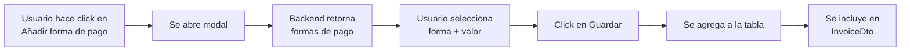

# 💳 Integración de Formas de Pago - Billing Module

## 📋 Resumen de la Implementación

Este documento describe la integración completa del sistema de formas de pago con el backend del microservicio EBill Billing.

---

## 🎯 Funcionalidad Implementada

### **1. Servicio de Formas de Pago**

**Archivo:** `src/app/_service/invoice/payment-method.service.ts`

```typescript
export interface PaymentMethodDto {
  idPaymentMethod: number;
  paymentMethodType: string;
  paymentMethodCode: string; // "01", "15", "16", "17", "18", "19", "20", "21"
  createdAt?: string;
  updatedAt?: string;
}

@Injectable({ providedIn: "root" })
export class PaymentMethodService {
  findAll(): Observable<PaymentMethodDto[]>;
}
```

**Endpoint:** `GET http://localhost:8480/api/payment-method`

---

### **2. Diálogo de Selección de Forma de Pago**

**Archivos creados:**

- `add-payment-dialog.component.ts`
- `add-payment-dialog.component.html`
- `add-payment-dialog.component.css`
- `add-payment-dialog.component.spec.ts`

**Características:**

- ✅ Carga dinámica de formas de pago desde el backend
- ✅ Dropdown con todas las opciones disponibles (8 métodos de pago)
- ✅ Validación de campos obligatorios
- ✅ Campos opcionales: Plazo y Tiempo (Años, Meses, Días)
- ✅ Spinner mientras carga los datos
- ✅ UI/UX consistente con el resto de la aplicación

---

## 🔄 Flujo de Uso



---

## 📡 Formas de Pago Disponibles

| Código | Descripción                                  |
| ------ | -------------------------------------------- |
| **01** | SIN UTILIZACION DEL SISTEMA FINANCIERO       |
| **15** | COMPENSACIÓN DE DEUDAS                       |
| **16** | TARJETA DE DÉBITO                            |
| **17** | DINERO ELECTRÓNICO                           |
| **18** | TARJETA PREPAGO                              |
| **19** | TARJETA DE CRÉDITO                           |
| **20** | OTROS CON UTILIZACIÓN DEL SISTEMA FINANCIERO |
| **21** | ENDOSO DE TÍTULOS                            |

---

## 🔧 Cambios Realizados

### **1. Actualización del Modelo `Payment`**

**Archivo:** `src/app/_model/invoice/payment.ts`

```typescript
export interface Payment {
  paymentType: string; // Nombre de la forma de pago
  paymentMethodCode?: string; // Código SRI (ej: "01", "16", "19")
  value: number; // Monto
  term?: number; // Plazo (opcional)
  time?: string; // Tiempo (Años, Meses, Días)
}
```

---

### **2. Actualización de `BillingComponent`**

**Cambios en:** `src/app/pages/billing/billing.component.ts`

#### **Método `addPayment()` refactorizado:**

```typescript
addPayment() {
  const dialogRef = this.dialog.open(AddPaymentDialogComponent, {
    width: '500px',
    maxWidth: '90vw',
    disableClose: false,
  });

  dialogRef.afterClosed().subscribe((paymentData) => {
    if (paymentData) {
      // Agregar a la tabla
      this.paymentsDataSource.data = [
        ...this.paymentsDataSource.data,
        paymentData,
      ];

      // Agregar al FormArray
      this.paymentItems.push(
        this.fb.group({
          paymentType: [paymentData.paymentType],
          paymentMethodCode: [paymentData.paymentMethodCode],
          value: [paymentData.value],
          term: [paymentData.term],
          time: [paymentData.time],
        })
      );

      this.snackBar.open('✅ Forma de pago agregada', 'OK', { duration: 2000 });
    }
  });
}
```

#### **Método `buildInvoicePayload()` actualizado:**

```typescript
// Método de pago principal
paymentMethod: {
  paymentMethodType: firstPayment.paymentType,
  paymentMethodCode: firstPayment.paymentMethodCode || '01', // Default
  value: Number(firstPayment.value),
  term: firstPayment.term,
  timeUnit: firstPayment.time,
}
```

---

### **3. Actualización de `billing.module.ts`**

```typescript
import { AddPaymentDialogComponent } from "./add-payment-dialog/add-payment-dialog.component";
import { MatProgressSpinnerModule } from "@angular/material/progress-spinner";

@NgModule({
  declarations: [
    BillingComponent,
    SelectProductDialogComponent,
    AddPaymentDialogComponent, // ✅ Nuevo
  ],
  imports: [
    // ... otros imports
    MatProgressSpinnerModule, // ✅ Nuevo
  ],
})
export class BillingModule {}
```

---

### **4. Configuración del Proxy**

**Archivo:** `proxy.conf.json`

```json
{
  "/api/payment-method": {
    "target": "http://localhost:8480",
    "secure": false,
    "changeOrigin": true,
    "logLevel": "debug"
  }
}
```

---

## 🎨 UI/UX del Diálogo

### **Campos del formulario:**

1. **Forma de Pago** (obligatorio)

   - Dropdown con opciones del backend
   - Formato: `01 - SIN UTILIZACION DEL SISTEMA FINANCIERO`

2. **Valor** (obligatorio)

   - Input numérico con prefijo `$`
   - Validación: mayor o igual a 0

3. **Plazo** (opcional)

   - Input numérico
   - Ejemplo: 12, 24, 36

4. **Tiempo** (opcional)
   - Dropdown: Años, Meses, Días
   - Solo se habilita si hay un plazo

---

## 🔒 Validaciones

### **Frontend:**

```typescript
paymentForm = this.fb.group({
  paymentMethodId: [null, Validators.required],
  value: [0, [Validators.required, Validators.min(0)]],
  term: [null],
  timeUnit: [null],
});
```

### **Backend:**

El backend valida que exista al menos una forma de pago en el `InvoiceDto` antes de crear la factura.

---

## 📊 Estructura del Payload

**Antes:**

```json
{
  "paymentMethod": {
    "paymentType": "Efectivo",
    "value": 100.0
  }
}
```

**Ahora:**

```json
{
  "paymentMethod": {
    "paymentMethodType": "SIN UTILIZACION DEL SISTEMA FINANCIERO",
    "paymentMethodCode": "01",
    "value": 100.0,
    "term": 12,
    "timeUnit": "Meses"
  }
}
```

---

## 🧪 Testing

### **Pruebas de integración:**

1. ✅ **Cargar formas de pago:** Verificar que el servicio retorne las 8 formas de pago
2. ✅ **Abrir modal:** Click en "Añadir forma de pago" debe abrir el diálogo
3. ✅ **Validación de campos:** No permitir guardar si falta información obligatoria
4. ✅ **Agregar a tabla:** La forma de pago debe aparecer en la tabla después de guardar
5. ✅ **Eliminar forma de pago:** Click en el icono de eliminar debe remover la fila
6. ✅ **Envío al backend:** El payload debe incluir el código correcto de la forma de pago

---

## 🚀 Cómo Usar

### **Paso 1:** Hacer click en el botón "Añadir forma de pago"

```
┌─────────────────────────────────────┐
│ Detalle forma de pago         [X]   │
├─────────────────────────────────────┤
│                                     │
│ Forma de Pago: [Seleccione ▼]      │
│                                     │
│ Valor: $ [        ]                 │
│                                     │
│ Plazo: [        ]                   │
│                                     │
│ Tiempo: [Seleccione ▼]              │
│                                     │
├─────────────────────────────────────┤
│           [Cancelar]  [Guardar]     │
└─────────────────────────────────────┘
```

### **Paso 2:** Seleccionar una forma de pago del dropdown

```
┌──────────────────────────────────────────────────┐
│ Forma de Pago: [01 - SIN UTILIZACION DEL...  ▼] │
│                                                  │
│ ▼ Seleccione                                     │
│   01 - SIN UTILIZACION DEL SISTEMA FINANCIERO    │
│   15 - COMPENSACIÓN DE DEUDAS                    │
│   16 - TARJETA DE DÉBITO                         │
│   17 - DINERO ELECTRÓNICO                        │
│   18 - TARJETA PREPAGO                           │
│   19 - TARJETA DE CRÉDITO                        │
│   20 - OTROS CON UTILIZACIÓN DEL SISTEMA...      │
│   21 - ENDOSO DE TÍTULOS                         │
└──────────────────────────────────────────────────┘
```

### **Paso 3:** Ingresar el valor y opcionalmente plazo/tiempo

```
Forma de Pago: [01 - SIN UTILIZACION...]
Valor: $ [1000.00]
Plazo: [12]
Tiempo: [Meses ▼]
```

### **Paso 4:** Click en "Guardar"

La forma de pago se agrega a la tabla:

```
┌──────────────────────────┬────────┬────────┬────────┬──────────┐
│ Forma de Pago            │ Valor  │ Plazo  │ Tiempo │ Acciones │
├──────────────────────────┼────────┼────────┼────────┼──────────┤
│ SIN UTILIZACION DEL...   │ $1000  │ 12     │ Meses  │   [🗑️]   │
└──────────────────────────┴────────┴────────┴────────┴──────────┘
```

---

## 🔍 Troubleshooting

### **Error: "Cannot load payment methods"**

- Verificar que el backend esté corriendo en puerto 8480
- Revisar que el endpoint `/api/payment-method` esté disponible
- Verificar proxy configuration en `proxy.conf.json`

### **Error: "Payment method code is missing"**

- Asegurarse de que el backend retorne el campo `paymentMethodCode`
- Verificar que el diálogo guarde correctamente el código seleccionado

### **El modal no se abre**

- Verificar que `AddPaymentDialogComponent` esté declarado en `billing.module.ts`
- Verificar que `MatProgressSpinnerModule` esté importado

---

## 📝 Próximas Mejoras

1. **Múltiples formas de pago:** Permitir agregar varias formas de pago para una factura
2. **Validación de monto total:** Verificar que la suma de formas de pago = total de la factura
3. **Edición de formas de pago:** Permitir editar una forma de pago ya agregada
4. **Guardar preferencias:** Recordar la última forma de pago utilizada
5. **Validación de plazo:** Solo habilitar "Plazo" para ciertos tipos de pago (ej: crédito)

---

## 🎉 Resultado Final

✅ **Sistema de formas de pago completamente funcional**
✅ **Integración con backend completa**
✅ **UI/UX consistente con el resto de la aplicación**
✅ **Validaciones implementadas**
✅ **Logging estructurado**
✅ **Documentación completa**

---

**Fecha de implementación:** Octubre 2025  
**Versión:** 1.0.0
